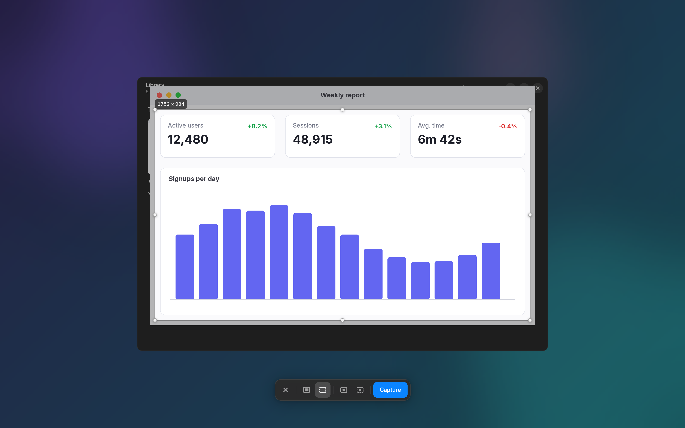

# Screen Capture

iris provides region, fullscreen, active-window, and timed capture modes.



## Capture Modes

Starting a capture closes a resting toast and notice first, so the capture does not contain them ([Auto-Dismiss Countdown](toast.md#auto-dismiss-countdown)).

While the region overlay, the region-recording overlay, or an X11 window pick is open, the daemon ignores a second capture, region pick, or recording start, from a shortcut, the tray, or the command line, and logs it in `iris.log`.

### Region Capture

Trigger region capture using any of the following interfaces:
- Keybind: `Ctrl+Print` (configured by `capture_hotkey` in [configuration.md#keyboard](configuration.md#keyboard))
- Command-line interface: `iris --capture` (see [cli.md#command-reference](cli.md#command-reference))
- Home window: **New Screenshot** tile
- Library window: **New Screenshot** toolbar button
- System tray menu: **New Screenshot**

The region overlay applies a dimming layer at 0.32 opacity immediately and freezes the screen into an image frame across all monitors.

Features in region capture mode:
- **Crosshair coordinate readout**: Displays the cursor's desktop coordinates in physical pixels (`x, y`) adjacent to the cursor. A monitor left of or above the primary has negative coordinates. The readout shifts position when approaching display boundaries.
- **Window hover snap**: Queries top-level windows in stacking order. Available on X11, Windows, and macOS. Unavailable on Wayland because Wayland compositors do not expose window layouts to client applications (see [platforms.md#platform-capabilities-matrix](platforms.md#platform-capabilities-matrix)). The hovered window rectangle un-dims with a 90-millisecond fade-in, and the previously hovered window fades out over 90 milliseconds. Clicking with less than 4.0 logical pixels of pointer movement selects that window and commits the capture.
- **Drag region selection**: Click and drag to define an area. Selections smaller than 3.0 logical pixels in width or height are cleared on release. Hold `Shift` while dragging to constrain the selection to a square. The selection boundary displays rounded physical dimensions (`width × height`) above the selection, or below if the top coordinate is under 44 logical pixels. An instruction line below the selection displays confirmation and cancellation bindings (`Enter capture   Escape cancel` by default).
- **Move while dragging**: Hold `Space` while dragging to move the selection at its current size; release `Space` to resize again from the moved start corner. The selection stops at display boundaries. Releasing the mouse button with `Space` held commits the selection as shown.
- **Loupe magnifier**: Active during drag and resize operations. Magnifies a 19×19 source pixel grid by 8× into a 152×152 logical pixel preview with crosshairs on the center pixel. An info banner below the loupe displays `{x}, {y}  #{hex}` with the center pixel's desktop coordinates in physical pixels and its lowercase 6-digit hexadecimal color value. Flips to the opposite side of the cursor near display edges.
- **Color copy**: Press `c` while dragging or resizing to copy the loupe center pixel color (`#rrggbb`) to the system clipboard. The info banner reads `Copied #rrggbb` until the pointer moves to another pixel.
- **Selection repositioning**: Click and drag inside an existing selection boundary (outside resize handles) to translate the selection across the screen, clamped to display boundaries.
- **Selection resizing**: Eight resize handles (10.0 logical pixels square each) are positioned at the four corners (NW, NE, SW, SE) and four edge midpoints (N, S, W, E). Dragging a handle resizes the selection; the loupe tracks the moving edge.
- **Nudge keys**: Press `Left`, `Right`, `Up`, or `Down` arrow keys to translate the selection by 1.0 logical pixel. Hold `Shift` with arrow keys to translate by 10.0 logical pixels. Coordinates clamp to display boundaries. During a drag the arrow keys move the drag's start corner with the selection.
- **Monitor snap**: Press number keys `1` through `9` to snap the selection to the corresponding monitor index.
- **Double-click commit**: Double-clicking inside the selection commits the capture.
- **Confirmation and Cancel**: Press `Enter` (or the configured `confirm_keybind`) to commit. Press `Escape` (or the configured `cancel_keybind`), or click the right mouse button, to cancel the capture.

The coordinate readout, the selection dimensions, the instruction line, and the loupe's info banner share one pill style: 11 pixel text with tabular digits, 8 by 3 logical pixel padding, 6 logical pixel corners, and a hairline border on the elevated fill at 90% opacity. Tabular digits hold a readout's width while its numbers change under the pointer.

### Fullscreen Capture

```sh
iris --capture-fullscreen
```

Grabs the union of all connected monitors into a single image frame without displaying the region overlay.

If `flash_on_capture` is true in [configuration.md#capture](configuration.md#capture) (default: `true`), displays a white flash window spanning the monitor union peaking at 0.38 opacity and easing out over 180 milliseconds. The flash opens after the frame is read, so it does not appear in the image. On X11 with no compositing manager, no flash opens ([Pop-up Windows](platforms.md#linux-x11)).

### Window Capture

```sh
iris --capture-window
```

Captures the focused window bounding rectangle, including window decorations, directly off the root screen without grabbing the full screen:
- **X11**: Queries `_NET_ACTIVE_WINDOW` and window geometry.
- **Windows**: Calls `GetForegroundWindow` and `GetWindowRect`.
- **macOS**: Reads the frontmost on-screen window from the window list.
- **Wayland**: Unavailable. Returns an error because Wayland compositors do not expose focused window identity or coordinates to client applications.

### Delayed Capture

```sh
iris --delay 5
```

Takes a whole number of seconds (`u64`). Any other value is an error ([Command-Line Interface](cli.md#command-reference)).

A card in the corner set by `toast_position` ([configuration.md#toast](configuration.md#toast)) counts down the seconds left: **Screenshot in 3 seconds**, then 2, then 1. At zero the card closes, and iris captures every display once the card is off the screen. The card's close button (tooltip **Cancel**) closes the card and cancels the capture. A second `--delay` replaces the pending one, card and capture. `--delay 0` captures at once with no card.

## Post-Capture Pipeline

When a capture commits, iris executes the following pipeline in order:
1. **Shutter Sound**: If `sound_on_capture` is true in [configuration.md#capture](configuration.md#capture) (default: `true`), plays audio at the grab moment:
   - **Linux**: Plays `/usr/share/sounds/freedesktop/stereo/camera-shutter.oga` through `pw-play`, falling back to `paplay`, then `canberra-gtk-play -i camera-shutter`.
   - **macOS**: Plays `/System/Library/Components/CoreAudio.component/Contents/SharedSupport/SystemSounds/system/Screen Capture.aif` (fallback `Grab.aif`) through `/usr/bin/afplay`.
   - **Windows**: Synthesizes a shutter click waveform in memory and plays it via `PlaySoundW` on the system-sounds volume channel.
   - Absence of audio utilities or files produces silence without error.
2. **Clipboard Copy**: If `copy_to_clipboard` is true in [configuration.md#capture](configuration.md#capture) (default: `true`), starts copying the RGBA pixels to the system clipboard on a dedicated background thread named `iris-clipboard`. The copy runs alongside the steps that follow.
3. **Directory Creation**: Creates `screenshots_dir` (default: `~/Pictures/iris`, see [configuration.md#storage](configuration.md#storage)) if the directory does not exist.
4. **PNG Encoding**: Encodes RGBA pixels to PNG in memory using Fast compression and Adaptive filtering on a background thread.
5. **Filename Reservation**: Formats the output path under `screenshots_dir` using `screenshot_template` (default: `"{date}_{time}"`). Substitutes `{date}` with `YYYY-MM-DD` and `{time}` with `HH-MM-SS` from a single local clock read. Creates the selected file without replacing an existing file, appending `_2.png`, `_3.png`, and ascending numbers on collision, as recordings do. Concurrent captures reserve different paths.
6. **Disk Save**: Writes the encoded PNG into the reserved file. A failed write removes the partial file.
7. **Pixel Stashing**: Caches decoded RGBA pixels in a process-wide single-slot memory cache so immediate thumbnail generation or annotation avoids re-decoding the saved file.
8. **Library Registration**: Starts a background thread named `iris-library`, which writes a cached thumbnail to disk and records image dimensions, file path, and creation timestamp into `library.json`. The toast opens without waiting on the thread. An open library window shows the capture once the entry is recorded, before the rewritten `library.json` reaches the disk. A failure keeps the capture file and shows the notice **Library update failed**.
9. **Interactive Toast**: If `show_toast_after_capture` is true in [configuration.md#toast](configuration.md#toast) (default: `true`), opens the toast stage. Region captures animate the capture card from selection coordinates to the resting card position over the live desktop; fullscreen and window captures display the toast directly (see [toast.md#toast-notifications](toast.md#toast-notifications)).
